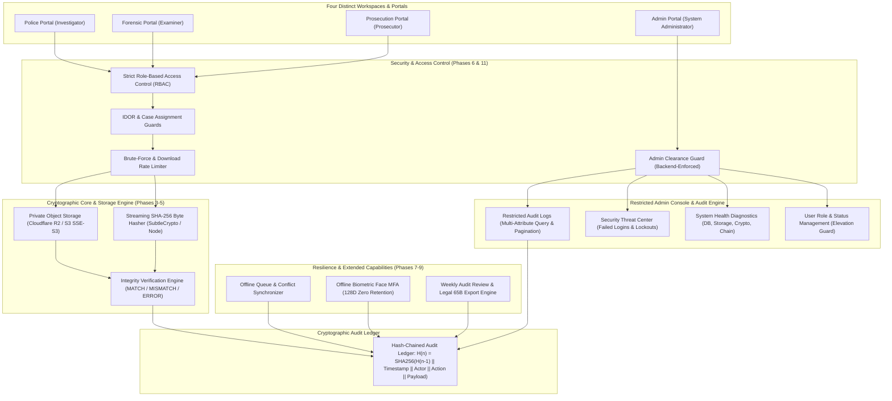

# EvidenceVault 360

> **One Case. Three Departments. Cryptographically Traceable Evidence.**  
> *Enterprise Digital Evidence Management, Zero-Egress Storage & Cryptographic Audit Assurance System*

---

## 1. System Overview & Architecture

**EvidenceVault 360** is an enterprise-grade digital evidence management system designed for the rigorous evidentiary chain-of-custody standards required by modern law enforcement, forensic laboratories, judicial prosecution, and national security administration.

It unifies four statutory departments across a single, immutable, relational data model backed by real-time cryptographic verification:

1. **Police Department:** Incident logging, case creation, forensic artifact acquisition, and digital evidence registration.
2. **Forensic Department:** Chain-of-custody handoff acceptance/rejection, bit-stream file verification, and version-preserved examination reports (`v1`, `v2`, ...).
3. **Prosecution Department:** Judicial case review, trial admissibility index generation, clarification requests, and Section 65B (Indian Evidence Act / BNSS) certification.
4. **Administration Department:** Dedicated Admin Portal restricted to `SYSTEM_ADMIN` personnel. Manages user roles and accounts, inspects restricted tamper-evident audit logs, monitors Security Center threats, and tracks live system health diagnostics.



---

## 2. Implemented Capabilities by Phase

| Phase | Category | Implemented Capabilities & Safeguards |
| :--- | :--- | :--- |
| **Phase 1-2** | **Relational Data Model** | Shared relational entities (`Case`, `EvidenceRecord`, `EvidenceFileVersion`, `EvidenceHandoff`, `CustodyEvent`, `ForensicReport`, `ProsecutionReview`, `AuditEvent`). Unique case reference index, foreign key validation, and state machine transition rules. |
| **Phase 3** | **Secure Object Storage** | Private object storage abstraction (`Cloudflare R2` / `S3`), path traversal prevention (`../../` sanitization), file-type whitelisting, quota enforcement, chunked multipart uploads, and ephemeral presigned download URLs. |
| **Phase 4** | **Cryptographic Verification** | Actual SHA-256 computation over storage bytes (not cached hashes), baseline manifest comparison, explicit `MATCH`, `MISMATCH` (tamper alert), and `ERROR` (storage missing) outcomes, streaming chunk hashing. |
| **Phase 5** | **Three-Portal UX** | Dedicated department login portals with high-contrast badge indicators, role-tailored dashboards, handoff rejection modals, and responsive layout. |
| **Phase 6** | **RBAC & Application Security** | Strict server-side authorization guards (backend checks, not merely hidden buttons), IDOR prevention, session timeout and token verification, brute-force rate limiting, and security incident audit logging without secret leaks. |
| **Phase 7** | **Offline Mode & Safe Sync** | `ONLINE`, `OFFLINE`, `SYNCING`, and `SYNC_FAILED` states. Metadata-only caching (zero raw blobs/reports offline). Idempotent event queuing with unique IDs, explicit conflict resolution, permission revalidation on reconnect, and partial sync handling. |
| **Phase 8** | **Offline Biometrics (MFA)** | Synthetic biometric MFA specification. Affirmative consent enrollment, immediate template purge on revocation, zero raw image retention (128D mathematical vectors only), liveness challenge validation, and secure password/PIN fallback. |
| **Phase 9** | **Weekly Audit Review & Reports** | Weekly observation window dashboard. Automated categorization of confirmed findings vs. warnings vs. suspicions. Unacknowledged handoff SLA detection (>48h), missing baseline/report detection, RFC-4180 CSV export with formula injection prevention (`'`, `=`, `+`, `-`), and Section 65B Indian Evidence Act / BNSS admissibility certificates. |
| **Phase 10** | **Disaster Recovery & E2E Tests** | Comprehensive automated verification suite covering end-to-end integration (Scenarios A through N), enterprise JSON backup export and disaster restoration engine with audit chain validation. |
| **Admin Portal** | **Restricted Admin Console & Audits** | Dedicated Admin portal (`SYSTEM_ADMIN` only) with 4-portal landing ingress. Backend-restricted audit log querying with multi-attribute filtering (date range, department, actor, action, target entity, status), search, pagination, Security Center threat detection, server-controlled user role & status management (`CONFIRM_ADMIN_ELEVATION` safeguard, last-admin protection), live system health telemetry, and formula-safe CSV exports. |

---

## 3. Getting Started & Setup Instructions

### Prerequisites
- **Node.js:** `v20.x` or higher (tested on Node `v24.13+`)
- **Package Manager:** `npm v10+`

### Installation
```bash
git clone https://github.com/your-org/evidencevault-360.git
cd evidencevault-360
npm install
```

### Environment Configuration
Copy `.env.example` to create your local environment file:
```bash
cp .env.example .env
```
Key configuration properties:
- `VITE_STORAGE_PROVIDER`: Set to `LOCAL_OBJECT_STORE` for offline hackathon demos, or `CLOUDFLARE_R2` for production cloud storage.
- `VITE_ENFORCE_STRICT_RBAC`: Enforces role-based operation guards.
- `VITE_ENFORCE_IDOR_PROTECTION`: Blocks unassigned officers from reading or downloading evidence.
- `VITE_AUDIT_HANDOFF_SLA_HOURS`: Threshold in hours (default: `48`) before unaccepted evidence handoffs trigger compliance warnings.

### Running the Application
```bash
npm run dev
```
The application will launch locally at `http://localhost:5173` (or `http://localhost:5174`).

---

## 4. Verification & Testing

### Automated Test Suite
EvidenceVault 360 features **91 automated tests** executed natively via Node's test runner (`node --test`), with zero third-party testing bloat:
```bash
npm test
```

### Production Build & Linting
Validate TypeScript compilation and static analysis rules:
```bash
npm run lint    # Executes oxlint (17 files, 116 rules checked)
npm run build   # Executes tsc -b and vite build (~430ms)
```

---

## 5. Enterprise Backup & Restoration Procedures

EvidenceVault 360 includes built-in enterprise disaster recovery mechanisms (`db.exportBackup()` and `db.restoreBackup()`):

### 1. Creating a Point-in-Time Backup Archive
```typescript
import { globalDb } from './src/data/db.ts';

// Generates an encrypted/canonical JSON representation of all tables,
// file metadata versions, custody handoffs, reports, and the complete audit ledger.
const backupJson = globalDb.exportBackup();
// Save `backupJson` to secure, air-gapped, write-once storage (WORM)
```

### 2. Restoring from a Backup Archive
```typescript
import { EvidenceVaultDatabase } from './src/data/db.ts';

const recoveryDb = new EvidenceVaultDatabase();
const result = await recoveryDb.restoreBackup(backupJson);

console.log(result);
// {
//   restored: true,
//   totalEntities: 42,
//   auditChainValid: true,
//   restoredAt: "2026-10-10T02:15:00.000Z"
// }
```
During restoration, the engine automatically verifies the cryptographic continuity of all hash-chained blocks (`H_n = SHA-256(H_{n-1} || ...)`). If any event payload or timestamp was altered inside the archive, `auditChainValid` reports `false`.

---

## 6. Hackathon Demonstration Script (Step-by-Step)

Follow this 5-minute repeatable demonstration script using synthetic demo cases:

### Step 1: Triple-Portal Login & Authentication
1. Open `http://localhost:5173`.
2. Notice the **Three Department Portals**: Police Investigator, Forensic Examiner, and Public Prosecutor.
3. Click **Police Portal (Sign In as Insp. Vikram Malhotra)**.
4. Observe the Police Dashboard with active cases, evidence acquisition intake, and custody status.

### Step 2: Evidence Registration & SHA-256 Manifest Baseline
1. Under **Register New Evidence Item**, fill in:
   - Case: `CASE-2026-001`
   - Description: `Server Bastion NVMe Dump`
   - Evidence Type: `DISK_IMAGE`
2. Select a file or upload synthetic bytes.
3. Observe live calculation of the SHA-256 baseline hash manifest.
4. Notice the file is securely stored in the private object store under a canonical, path-traversal-free storage key (`cases/.../v1/...`).

### Step 3: Evidence Custody Transfer to Forensic Lab
1. Under **Chain-of-Custody Handoffs**, dispatch the newly registered evidence to the **Forensic Department**.
2. Notice the handoff enters `SUBMITTED` state, creating an immutable `CustodyEvent` and appending block `AUD-XXX` to the audit ledger.

### Step 4: Forensic Examiner Intake & Integrity Verification (MATCH)
1. Switch department session to **Forensic Department (Dr. Aris Thorne)**.
2. Under **Pending Handoffs**, click **Acknowledge & Receive Evidence**. Status transitions to `RECEIVED`.
3. In the **Forensic Examination Lab**, click **Verify Storage Bytes (Run SHA-256 Check)**.
4. Observe the green **MATCH** badge: the streamed object storage bytes match the police baseline hash bit-for-bit.

### Step 5: Live Tamper Detection Simulation (MISMATCH)
1. In the Forensic Lab demo controls, click **Simulate Bit-Flip / File Tamper**.
2. Re-run verification.
3. Observe the prominent red **MISMATCH** alert: expected hash vs. observed hash are displayed side-by-side with actor ID and ISO timestamp.
4. An immediate `CONFIRMED CRITICAL` audit alert is dispatched to the audit log.

### Step 6: Version-Preserved Forensic Examination Report
1. In the report editor, document findings: `"Accounting logs corroborate unauthorized exfiltration"`.
2. Save report as `v1`. Make an amendment and save as `v2`.
3. Observe that `v1` remains permanently archived and immutable alongside `v2`.
4. Click **Submit to Prosecution**.

### Step 7: Prosecution Review, BNSS 65B Certificate & Weekly Audit Export
1. Switch to **Prosecution Portal (Adv. Priya Sharma)**.
2. Open the case to inspect the **Case Evidence Index**.
3. View the **Section 65B Electronic Evidence Certificate (under Indian Evidence Act / BNSS)** generated automatically with hash manifests and device identifiers.
4. Navigate to the **Weekly Audit Review** tab.
5. Click **Run Comprehensive Audit** & **Export CSV Audit Index**.
6. Verify the exported CSV contains RFC-4180 escaping and spreadsheet formula injection protection.

---

## 7. Legal Admissibility Notes (Section 65B BNSS / Indian Evidence Act)

Digital evidence admissibility in criminal jurisprudence requires affirmative proof of system integrity and unbroken custody:
- **Baseline Hash Preservation:** The SHA-256 calculated at first acquisition remains immutable.
- **Custody Logging:** Every custodian handoff, acceptance, and rejection records timestamps, identities, and department transitions.
- **Automated Certificate Generation:** EvidenceVault 360 outputs a pre-formatted Section 65B Electronic Record Certificate summarizing system operations, custodian affirmations, and hash verification logs ready for judicial submission.

---

## 8. Known Limitations

1. **Client In-Memory Demonstration:** For offline hackathon demonstrations, the database defaults to an in-memory repository with local storage persistence. Production deployments map this interface directly to PostgreSQL with row-level security (RLS).
2. **Biometrics Hardware Scope:** In accordance with the Phase 8 specification, facial verification functions strictly as a step-up Multi-Factor Authentication (MFA) challenge. It is never used as the sole authentication factor or stored in raw image form.
