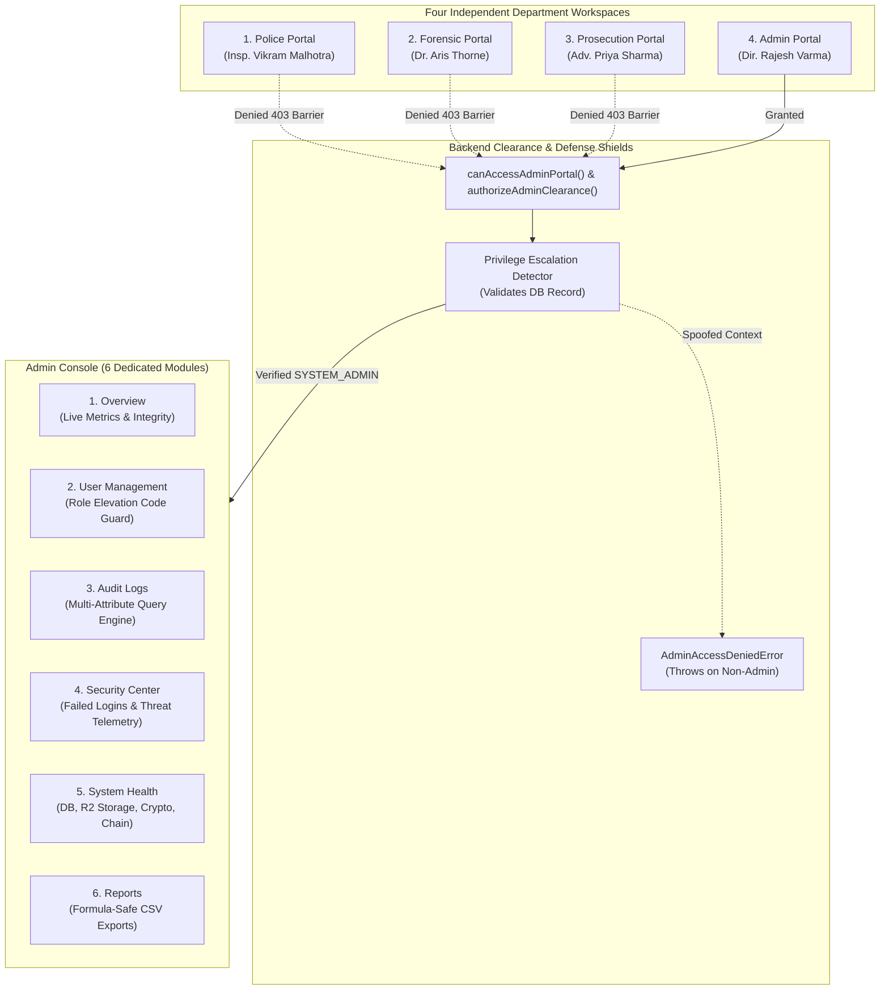

# EvidenceVault 360 — Dedicated Admin Portal & Restricted Audit Logs

## Executive Summary

EvidenceVault 360 has been upgraded with a **Dedicated Admin Portal** and **Strictly Restricted Audit Logs**, establishing **four distinct workspaces** across the enterprise:

1. **Police Portal** (`POLICE_INVESTIGATOR`): Incident logging, case creation, forensic artifact acquisition, and digital evidence registration.
2. **Forensic Portal** (`FORENSIC_EXAMINER`): Chain-of-custody handoff acceptance/rejection, bit-stream file verification, and version-preserved examination reports (`v1`, `v2`, ...).
3. **Judicial / Prosecution Portal** (`PUBLIC_PROSECUTOR`): Case review, trial admissibility index, clarification requests, and Section 65B certification.
4. **Dedicated Admin Portal** (`SYSTEM_ADMIN`): Authoritative administrative control plane featuring 6 dedicated operational modules.

---

## Key Capabilities & Architecture



### 1. Dedicated Admin Portal Ingress & Workspace Isolation
- **Separate Ingress Card:** High-contrast Gold/Bronze theme (`.card-admin`) on the landing page with dedicated avatar (`/admin_avatar.jpg`) and service credential (`DIR-NAT-SECURITY-001`).
- **Complete Workspace Inaccessibility:** Police, Forensic, and Prosecution accounts cannot reach the Admin Portal through interface clicks, routing navigation, API parameters, or direct database calls.
- **Fail-Safe UI Barrier:** Any non-admin attempting ingress encounters an immutable `<div className="ev-access-denied-barrier">` logging a security violation.

### 2. Admin-Only Restricted Audit Logs
- **Strict Backend Protection:** `getAuditEvents()` and `queryAuditLogs()` enforce `AdminAccessDeniedError` at the database level.
- **Enriched Forensic Metadata:** Every block captures:
  - User identity and role (`actor_id`, `actor_role`)
  - Department (`POLICE`, `FORENSIC`, `PROSECUTION`, `ADMINISTRATION`)
  - Action performed (`CREATE_CASE`, `EVIDENCE_REGISTERED`, `AUTH_LOGIN_FAILED`, etc.)
  - Target entity ID (`entity_id`, `case_id`, `evidence_id`)
  - ISO timestamp (`timestamp`)
  - Action result and status (`SUCCESS`, `FAILURE`)
  - Rejection / error reason (`reason`)
  - Client network IP (`ip_address`)
  - Browser User-Agent (`user_agent`)
  - Cryptographic block hash (`event_hash`) and parent hash (`previous_event_hash`)
- **Multi-Attribute Authoritative Filtering:** Filter by Department, Action Category, Actor ID, Target Entity ID, and Date Range, plus live search and pagination.

### 3. Server-Controlled User Management & Administrative Safeguards
- **Mandatory Elevation Confirmation:** Changing any user's role to `SYSTEM_ADMIN` strictly requires the confirmation code `CONFIRM_ADMIN_ELEVATION`.
- **Last Active Admin Protection:** `updateUserStatus()` blocks deactivating or suspending the last active administrator.
- **Zero Credential Leaks:** Passwords, cryptographic keys, and sensitive tokens are strictly redacted and never exposed.

### 4. Security Center & Failed-Login Telemetry
- Captures failed login attempts, bad badge entries, and simulated authentication attacks.
- Real-time display of brute-force lockouts, IDOR denials, and path traversal blocks.

### 5. Live System Health Diagnostics
- Telemetry across Relational Database, Cloudflare R2 Private Storage (SSE-S3), Cryptographic Hasher (NIST FIPS 180-4), and Hash Chain ledger.

### 6. Formula-Safe CSV Compliance Export
- Implements RFC-4180 escaping and neutralizes CSV formula injection attacks by prefixing dangerous triggers (`=`, `+`, `-`, `@`) with `'`.

---

## Verification & Test Results

```
✔ Phase 10 - Tests A through N: End-to-End Integration Suite (14 tests passed)
✔ Core Repository & Security Engine Suite (63 tests passed)
✔ Admin Dashboard & Restricted Audit Logs Suite (14 tests passed)

Total Test Execution:
ℹ tests 91
ℹ suites 0
ℹ pass 91
ℹ fail 0
ℹ cancelled 0
ℹ skipped 0
ℹ todo 0
ℹ duration_ms 562.7ms
```

### Compiler & Static Analysis
- **TypeScript (`tsc -b`):** 0 errors.
- **Linter (`oxlint`):** 0 errors across 19 files.
- **Production Bundle (`vite build`):** Built successfully in 644ms.
