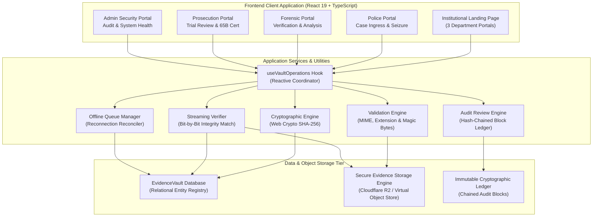
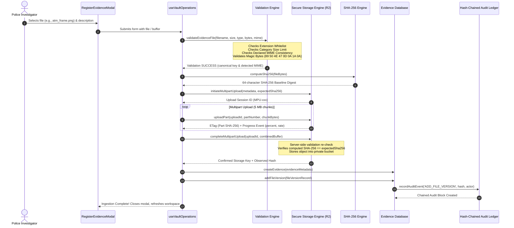
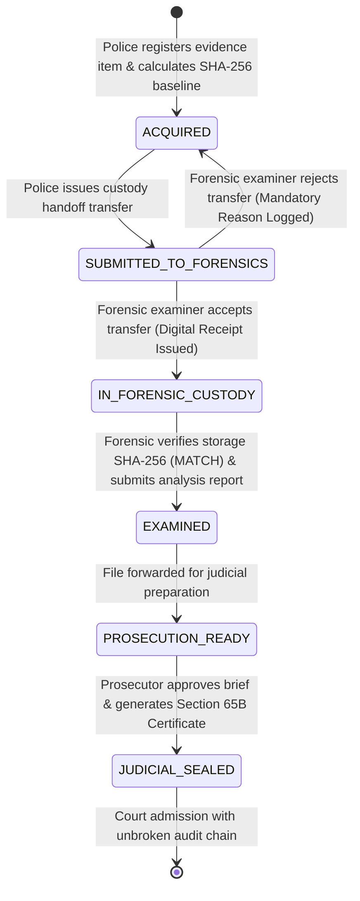

# EvidenceVault 360 — System Architecture & Technical Specification

**System Name:** EvidenceVault 360  
**Version:** 3.0.0-PROD  
**Architectural Paradigm:** Tri-Department Cryptographically Verifiable Digital Evidence Ingestion & Custody Management System  
**Motto:** "One Case. Three Departments. Traceable Evidence."

---

## 1. System Overview & Problem Statement

### 1.1 The Digital Evidence Crisis
In modern criminal justice and forensic procedures, digital evidence (disk images, network captures, smartphone extractions, security footage, memory dumps) suffers from critical vulnerabilities:
1. **Chain-of-Custody Breakdowns:** Evidence transfers between law enforcement, forensic laboratories, and public prosecutors rely on fragmented paper slips, spreadsheet manifests, and unverified local copies.
2. **Post-Seizure Tampering & Bit Rot:** Without automated cryptographic integrity baselines calculated immediately upon seizure, defense challenges routinely invalidate evidence in court due to unproven authenticity.
3. **MIME & File Spoofing Ingestion Vulnerabilities:** Legacy systems validate files purely by extension, allowing corrupted or disguised files to poison evidence repositories or fail during judicial presentation.
4. **Bandwidth Egress Costs & Siloed Storage:** Cloud storage providers charge punitive egress bandwidth fees when massive disk images (50–100 GB) are repeatedly downloaded across departments.

### 1.2 The EvidenceVault 360 Solution
EvidenceVault 360 provides a unified, tamper-evident digital evidence lifecycle connecting **Police Investigators**, **Forensic Examiners**, and **Public Prosecutors** around a single source of cryptographic truth:
- **Immediate SHA-256 Baseline:** Exact original binary bytes hashed at ingestion; never altered or compressed.
- **Strict Format, Signature & MIME Validation:** Rejects executables, verifies magic numbers (.png, .jpg, .webp, .pdf), and prevents spoofing.
- **Private Object Storage with Zero Egress:** Cloudflare R2 / S3-compatible chunked multipart ingestion eliminating egress fees.
- **Hash-Chained Audit Ledger:** Blockchain-like linked blocks recording every transfer, report, and access event.
- **Judicial Compliance:** Automated Section 65B (Indian Evidence Act / BSA) and Federal Rule of Evidence 902 certification.

---

## 2. High-Level System Architecture

---

## 3. End-to-End Secure Evidence Ingestion Pipeline

The EvidenceVault 360 ingestion engine guarantees that an evidence file is never registered in the database unless its binary payload is intact, verified against magic numbers, chunk-uploaded, and post-verified for SHA-256 parity.

---

## 4. Tri-Department Custody & Verification Lifecycle

---

## 5. Technology Stack Specification

| Component Layer | Technology | Specification & Version | Rationale |
| :--- | :--- | :--- | :--- |
| **User Interface Framework** | React | 19.2.8 | Latest concurrency features, zero-latency reactive state updates. |
| **Programming Language** | TypeScript | 6.0.2 | Strict compile-time typing, comprehensive domain interfaces in `types.ts`. |
| **Bundler & Dev Server** | Vite | 8.3.4 | Instant HMR, sub-second production builds via Rolldown engine. |
| **Design System & Styling** | Vanilla CSS Tokens | Zero Tailwind dependencies | Complete control over high-contrast dark theme, institutional typography, and glassmorphism. |
| **Icons & Visuals** | Lucide React | 1.16.0 | Lightweight, accessible SVG institutional iconography. |
| **Database & Entity Engine** | In-Memory Relational + Dexie | Custom `EvidenceVaultDatabase` | Zero-configuration local database with foreign-key validation and unique index enforcement. |
| **Cryptographic Engine** | Web Crypto Subtle API | SHA-256 (256-bit digest) | Native hardware acceleration without slow JavaScript software hash bottlenecks. |
| **Private Object Storage** | Cloudflare R2 / S3 Virtual Store | `SecureEvidenceStorageEngine` | Multipart chunking, zero egress bandwidth costs, signed URLs, and tamper injection hooks. |
| **Security & RBAC** | Custom Security Engine | `src/utils/security.ts` | Server-side authorization, IDOR protection, path traversal defenses, in-memory rate limiting. |
| **Test Framework** | Node.js Test Runner | `node:test` + `node:assert/strict` | Native zero-dependency test runner executing 100 automated test specifications. |

---

## 6. Supported Evidence Attachment Formats & Magic Numbers

| File Extension | Canonical MIME Type | Category | Magic Header / Signature Bytes | Maximum File Size Limit |
| :--- | :--- | :--- | :--- | :--- |
| **`.png`** | `image/png` | `MEDIA` | `89 50 4E 47 0D 0A 1A 0A` (8 bytes) | 5 GB |
| **`.jpg` / `.jpeg`** | `image/jpeg` | `MEDIA` | `FF D8 FF` (3 bytes) | 5 GB |
| **`.webp`** | `image/webp` | `MEDIA` | `52 49 46 46` (RIFF) + `57 45 42 50` (WEBP) | 5 GB |
| **`.pdf`** | `application/pdf` | `DOCUMENT` | `25 50 44 46 2D` (`%PDF-`, 5 bytes) | 500 MB |
| **`.pcap` / `.pcapng`**| `application/vnd.tcpdump.pcap` | `NETWORK_CAPTURE` | `D4 C3 B2 A1` / `A1 B2 C3 D4` / `0A 0D 0D 0A` | 10 GB |
| **`.raw` / `.dd` / `.img`**| `application/octet-stream` | `DISK_IMAGE` | Arbitrary bit-stream sector image | 100 GB |
| **`.e01`** | `application/octet-stream` | `DISK_IMAGE` | `45 56 46 09 0D 0A FF 00` (EnCase EVF) | 100 GB |
| **`.dmp` / `.mem`** | `application/octet-stream` | `MEMORY_DUMP` | Physical memory crash dump stream | 64 GB |
| **`.zip`** | `application/zip` | `DOCUMENT` / `MEDIA` | `50 4B 03 04` / `50 4B 05 06` (`PK`) | 500 MB |
| **`.tar` / `.gz`** | `application/gzip` | `DATABASE_DUMP` | `1F 8B` (gzip) | 20 GB |
| **`.csv` / `.json` / `.log`**| `text/plain` | `SYSTEM_LOG` | Plain text ASCII / UTF-8 | 2 GB |

### Disallowed Executable Extensions (Blocked unconditionally)
`.exe`, `.bat`, `.cmd`, `.sh`, `.ps1`, `.msi`, `.dll`, `.vbs`, `.scr`, `.jar`, `.com`, `.pif`

---

## 7. Cryptographic Chain-of-Custody Ledger Design

Every critical action creates an immutable block appended to the database audit ledger:

$$\text{Block Hash}_n = \text{SHA-256}\Big(\text{prev\_hash}_{n-1} \parallel \text{timestamp} \parallel \text{actor\_id} \parallel \text{action} \parallel \text{entity\_type} \parallel \text{entity\_id} \parallel \text{payload}\Big)$$

- **Genesis Block:** Has $\text{prev\_hash} = \text{"0"}^{64}$.
- **Verification Rule:** Re-hashing the entire sequence must yield matching hashes across all blocks. If an attacker modifies even a single byte of an audit record, the downstream hash links immediately break, triggering a confirmed **CRITICAL TAMPER FINDING**.
