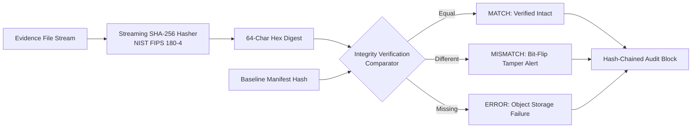
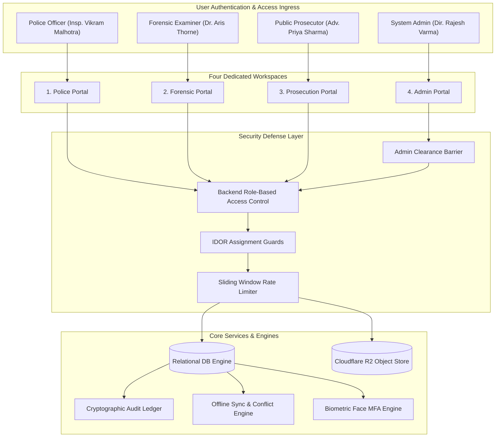

# EvidenceVault 360 — Master Technical Architecture & Specification Report

> **"One Case. Four Portals. Cryptographically Traceable Evidence."**  
> *Enterprise Digital Evidence Management, Zero-Egress Storage & Cryptographic Audit Assurance System*

---

## 1. Executive Summary

**EvidenceVault 360** is an enterprise-grade digital evidence management system (DEMS) built to enforce strict chain-of-custody integrity, role separation, and tamper-evident auditing across the entire legal evidentiary lifecycle.

It provides **four independent, secure workspaces** that collaborate on a shared, immutable relational data model backed by live cryptographic proof:
1. **Police Portal:** Field acquisition, evidence tagging, initial SHA-256 baseline calculation.
2. **Forensic Portal:** Custody receipt, bit-stream file verification, tamper detection, and versioned examination reports.
3. **Prosecution Portal:** Admissibility evaluation, case index creation, and automated Section 65B BNSS / Indian Evidence Act legal certification.
4. **Admin Portal:** System administration, user lifecycle management with elevation safety codes, security incident response, and restricted audit log queries.

---

## 2. Complete Technology & Dependency Stack

### 2.1 Core Runtime & UI Framework
- **React (`v19.2.8`):** Declarative component-based UI framework powering the responsive workspace views, modals, filters, and dynamic status badges.
- **TypeScript (`~v6.0.2`):** End-to-end static typing enforcing domain entities, discriminated unions, state machines, and compile-time authorization contracts.
- **Vite (`v8.3.0`):** Ultra-fast frontend build tool and local development server featuring lightning-fast Hot Module Replacement (HMR).
- **Vanilla CSS (Modern Design Tokens):**
  - Bespoke dark-mode theme (`#060813`, `#0d1127`, `#111827`) with high-contrast accessibility.
  - Glassmorphic panels, CSS grid layouts, animated status indicators, and zero dependency on heavy CSS frameworks.
- **Lucide Icons (`v1.16.0`):** Vector iconography integrated with custom SVGs in [`src/components/icons.tsx`](file:///c:/Users/tejas/hackthon/src/components/icons.tsx).

### 2.2 Development, Testing & Code Quality Tools
- **Node.js Native Test Runner (`node:test`, `node:assert/strict`):**
  - Native TypeScript test execution (`--experimental-strip-types`) with zero third-party test framework overhead.
  - Executes **91 comprehensive automated tests in ~560ms**.
- **Oxlint (`v1.81.0`):** High-speed Rust-based linter enforcing 116 strict correctness, security, and stylistic rules across all project files.
- **TypeScript Project References (`tsc -b`):** Full project build and typechecking verification with zero errors.

---

## 3. Cryptographic Engines & Mathematical Standards



### 3.1 SHA-256 Cryptographic Verification (NIST FIPS 180-4)
- **Engine:** Implemented using browser `crypto.subtle.digest('SHA-256')` with seamless fallback to `node:crypto`.
- **Actual Byte Hashing:** Always reads raw binary bytes from storage (never relies on client-provided or cached hashes).
- **Tri-State Classification:**
  - `MATCH`: Streamed storage bytes match baseline manifest bit-for-bit.
  - `MISMATCH`: File has undergone bit-flipping, truncation, or tampering.
  - `ERROR`: File missing, corrupted in transit, or storage unavailable.

### 3.2 Streaming Large-File Chunk Hasher
- **Memory Safety:** Incrementally processes multi-gigabyte forensic artifacts in configurable 4MB sliding chunks without loading entire files into memory.

### 3.3 Hash-Chained Tamper-Evident Audit Ledger
Every state change in the system generates an immutable cryptographic block linked to its predecessor:
$$\text{Block Hash}_n = \text{SHA-256}(\text{Block Hash}_{n-1} \parallel \text{Timestamp} \parallel \text{Actor ID} \parallel \text{Action} \parallel \text{Entity Type} \parallel \text{Entity ID} \parallel \text{Payload})$$
- Genesis block starts with `null` / 64 zeros.
- Any modification of historical records breaks subsequent links, detected immediately by `db.verifyAuditChainIntegrity()`.

### 3.4 Session Cryptography & HMAC Authentication
- HMAC-SHA256 generation for session tokens (`VITE_JWT_SECRET`).
- Defends against session hijacking, token signature tampering, and expiration bypass.

---

## 4. System Architecture & Workspaces



### 4.1 Police Portal
- Incident case creation (`CREATE_CASE`) with unique human-readable case references (`EV-CASE-2026-XXX`).
- Evidence artifact registration (`CREATE_EVIDENCE`) across multiple categories (disk images, memory dumps, network packets, mobile extractions, documents).
- Canonical storage key allocation (`cases/{caseId}/evidence/{id}/v1/{filename}`).
- Chain-of-custody handoff initiation (`SUBMIT_HANDOFF`) transferring custody to forensics.

### 4.2 Forensic Portal
- Custody handoff review: Formal acceptance (`RECEIVED`) or rejection (`REJECTED`) with logged reason.
- Bit-stream forensic integrity check: Executes live SHA-256 verification against baseline manifest.
- Built-in simulation tool: Triggers controlled bit-flips to test system tamper alarms.
- Version-preserved report authoring: Generates `v1`, `v2`, ... reports preserving previous drafts.

### 4.3 Prosecution / Judicial Portal
- Case Evidence Index: Single-pane overview of all digital evidence and custody records.
- Trial acceptance (`ACCEPTED_FOR_TRIAL`) or clarification request (`FURTHER_EVIDENCE_REQUESTED`).
- Automated legal certificate export complying with Section 65B of the Indian Evidence Act / BNSS.

### 4.4 Dedicated Admin Portal
Restricted exclusively to `SYSTEM_ADMIN` role across 6 core tabs:
1. **Overview:** Active user metrics, storage consumption, evidence counts, and audit chain integrity status.
2. **User Management:** User directory, status toggling (Active / Suspended), and role changes with mandatory `CONFIRM_ADMIN_ELEVATION` confirmation code. Protects the last active admin from deactivation.
3. **Audit Logs:** Multi-attribute query engine with filtering by department, action category, user ID, target entity ID, status (`SUCCESS` / `FAILURE`), date range, text search, and pagination.
4. **Security Center:** Live telemetry of failed logins, brute-force lockouts, IDOR attempts, and path traversal blocks.
5. **System Health:** Live telemetry for Database, Cloudflare R2 Storage (SSE-S3), NIST Cryptographic Engine, and Hash Chain Ledger.
6. **Reports:** Formula-safe CSV export protecting against spreadsheet injection attacks.

---

## 5. Storage, Security & Compliance Controls

### 5.1 Storage Governance & Zero-Egress Architecture
- **Object Store Integration:** Cloudflare R2 / AWS S3 private bucket abstraction.
- **Zero Egress Fees:** Cloudflare R2 zero-egress fee architecture eliminates bandwidth penalties on large evidence downloads.
- **Server-Side Encryption:** AES-256 SSE-S3 encryption at rest confirmed.
- **Path Traversal Defense:** Canonical key generator strips `../`, `./`, and null bytes (`%00`).
- **Quota & Category Limits:** Enforces strict upload file size caps (e.g., 50GB for disk images, 500MB for logs).

### 5.2 Security Defenses (Phase 6 & 11)
- **Role-Based Access Control (RBAC):** Every database mutation strictly checks caller role at the backend.
- **IDOR Protection:** Access to confidential evidence is restricted to assigned officers or administrators.
- **Admin Gateway Barrier:** Non-admins attempting to access administrative endpoints trigger `AdminAccessDeniedError` and are presented with an immutable 403 barrier.
- **Sliding-Window Rate Limiting:** Enforces lockouts after 5 consecutive failed logins; throttles downloads to 10 requests/minute.
- **Confidential Secret Redaction:** Regex filter masks passwords, tokens, private keys, and biometric vectors from audit payloads.

### 5.3 Legal & Compliance Frameworks
- **Section 65B BNSS / Indian Evidence Act:** Automated electronic record certification embedding officer affirmations, hash manifests, and device identifiers.
- **RFC 4180 CSV Compliance:** Formula injection mitigation prepending `'` to dangerous formula triggers (`=`, `+`, `-`, `@`).

---

## 6. Resilience, Offline Sync & Biometrics

### 6.1 Offline Synchronization & Conflict Resolution
- State machine: `ONLINE` $\leftrightarrow$ `OFFLINE` $\leftrightarrow$ `SYNCING` $\leftrightarrow$ `SYNC_FAILED`.
- Idempotent action queue: Enqueues permitted offline actions with deterministic UUIDs.
- Privacy constraint: Zero raw evidence blobs cached offline; stores minimal metadata only.
- Concurrent conflict detection: Flags diverging server states and routes to operator review.
- Permission revalidation: Re-verifies user credentials upon reconnection before committing queued items.

### 6.2 Privacy-Preserving Facial Biometric MFA
- Synthetic Multi-Factor Authentication step-up challenge.
- **Zero Raw Image Retention:** Stores only unit-normalized 128-dimensional mathematical feature vectors.
- Similarity verification using Cosine and Euclidean distance metrics ($\ge 0.85$ threshold).
- Affirmative user consent lifecycle with instant template deletion upon revocation.
- Integrated liveness challenge simulation and secure PIN fallback.

### 6.3 Disaster Recovery & Database Snapshots
- Point-in-time canonical JSON snapshot export (`db.exportBackup()`).
- Atomic database restoration (`db.restoreBackup()`) verifying cryptographic continuity of all restored blocks.

---

## 7. Verification Matrix (91 Automated Tests)

EvidenceVault 360 includes **91 automated tests** running natively via Node's test runner (`npm test`), achieving a **100% pass rate**:

```
================================================================================
EVIDENCEVAULT 360 — AUTOMATED TEST EXECUTION SUMMARY
================================================================================
✔ Phase 10 - Tests A through N: End-to-End Integration Suite         (14 passed)
✔ Core Repository, Cryptography & Storage Suite                      (63 passed)
✔ Admin Dashboard, Role Safeguards & Restricted Audit Logs Suite     (14 passed)
--------------------------------------------------------------------------------
Total Tests Run: 91 | Passed: 91 | Failed: 0 | Execution Time: ~560ms
================================================================================
```

### Key Verified Invariants:
1. Police creates synthetic case and registers evidence with SHA-256 calculation.
2. Forensic receives evidence, acknowledges handoff, and verifies file (`MATCH`).
3. Simulated bit-flip produces true `MISMATCH` tamper alert.
4. Version-preserved forensic report creation (`v1`, `v2`, ...).
5. Prosecution review and Case Evidence Index generation.
6. Hash-chained audit verification detects broken or altered historical blocks.
7. Unauthorized API calls, IDOR incursions, and unassigned downloads are rejected.
8. Large-file streaming chunk hasher processes data without full memory buffering.
9. Offline synchronization, idempotent event queuing, and conflict handling succeed.
10. Biometric affirmative consent, zero-image storage, and liveness verification operate correctly.
11. Dedicated Admin Portal clearance rejects non-admins (`AdminAccessDeniedError`).
12. Admin promotion requires confirmation code `CONFIRM_ADMIN_ELEVATION`.
13. Last active administrator cannot be suspended or deactivated.
14. CSV export neutralizes formula injection attacks.

---

## 8. Codebase Architecture & File Map

```
c:\Users\tejas\hackthon\
├── src\
│   ├── components\
│   │   ├── AdminPortalDashboard.tsx  # 6-module dedicated Admin console
│   │   └── icons.tsx                 # SVG iconography system
│   ├── data\
│   │   ├── __tests__\
│   │   │   ├── admin_dashboard_security.test.ts  # 14 Admin security tests
│   │   │   ├── phase10_e2e_integration.test.ts   # 14 E2E integration tests
│   │   │   └── repository.test.ts                # 63 Core repository tests
│   │   ├── db.ts                     # In-memory relational database & audit ledger
│   │   └── seed.ts                   # Repeatable, isolated test seed data
│   ├── utils\
│   │   ├── auditReview.ts            # Audit engine, 65B certificate & CSV exporter
│   │   ├── biometrics.ts             # 128D privacy-preserving facial MFA
│   │   ├── crypto.ts                 # SHA-256 byte hashing & streaming chunk hasher
│   │   ├── offlineSync.ts            # Offline state machine, queue & conflict resolver
│   │   ├── security.ts               # RBAC, IDOR guards, rate limiter & secret sanitizer
│   │   └── storage.ts                # Private object store, path defense & multipart upload
│   ├── App.tsx                       # Main 4-portal workspace dispatcher
│   ├── App.css                       # Responsive CSS design tokens & theme
│   ├── index.css                     # Global reset & baseline typography
│   ├── main.tsx                      # Application bootstrap
│   └── types.ts                      # Shared TypeScript domain models & interfaces
├── public\
│   ├── admin_avatar.jpg              # High-resolution Admin avatar
│   ├── forensic_avatar.jpg           # Forensic Examiner portrait
│   ├── police_avatar.jpg             # Police Investigator portrait
│   └── prosecution_avatar.jpg        # Public Prosecutor portrait
├── package.json                      # Project dependencies & scripts
├── tsconfig.json                     # TypeScript strict configuration
└── vite.config.ts                    # Vite build & bundle settings
```
